# Labour ERP System Architecture Blueprint

## 1. Executive Summary

This document defines the target architecture for a Labour ERP system built for construction contractors. The platform is designed to manage workers, attendance, payroll, project sites, expenses, documents, and operational reporting in a single system.

The recommended implementation approach is:

- Architecture style: Modular monolith first, with clear domain boundaries
- Client channels: Web admin portal, supervisor mobile web/app, worker self-service optional in later phases
- API style: RESTful JSON APIs with versioning
- Database: PostgreSQL as the system of record
- File storage: Object storage for documents and attachments
- Reporting: Transactional reports in-app, analytical reporting via optimized read models/materialized views

This approach keeps early delivery fast and maintainable, while preserving a clean path to future microservice extraction if scale or team size demands it.

## Companion Documents

This blueprint is now supported by additional planning documents:

- [docs/README.md](C:/Users/Asus/python/labour_v0/docs/README.md)
- [docs/product/PRODUCT_REQUIREMENTS.md](C:/Users/Asus/python/labour_v0/docs/product/PRODUCT_REQUIREMENTS.md)
- [docs/product/USER_ROLES_AND_PERMISSIONS.md](C:/Users/Asus/python/labour_v0/docs/product/USER_ROLES_AND_PERMISSIONS.md)
- [docs/product/WORKFLOWS_AND_SCREENS.md](C:/Users/Asus/python/labour_v0/docs/product/WORKFLOWS_AND_SCREENS.md)
- [docs/architecture/SQLITE_DATABASE_DESIGN.md](C:/Users/Asus/python/labour_v0/docs/architecture/SQLITE_DATABASE_DESIGN.md)
- [docs/architecture/IMPLEMENTATION_GUIDELINES.md](C:/Users/Asus/python/labour_v0/docs/architecture/IMPLEMENTATION_GUIDELINES.md)
- [docs/project/DEVELOPMENT_ROADMAP.md](C:/Users/Asus/python/labour_v0/docs/project/DEVELOPMENT_ROADMAP.md)

## 2. Business Goals

- Centralize labour operations for contractors across multiple sites
- Reduce payroll leakage caused by attendance errors, duplicate workers, and manual calculations
- Improve visibility into site-level labour cost and expenses
- Maintain worker identity, compliance, and employment records
- Provide timely operational and management reports
- Create a secure audit trail for approvals, payroll, and financial changes

## 3. Core Functional Scope

### In Scope

- Worker Management
- Attendance Management
- Payroll Management
- Site Management
- Expense Tracking
- Reports
- Document Management

### Future Scope

- Contractor/vendor billing
- Procurement and inventory
- Geo-fenced attendance
- Biometric/device integrations
- Worker self-service portal
- Statutory compliance automation
- Multi-company shared service model

## 4. Key Assumptions

- A contractor may operate many sites at the same time
- Workers may move between sites over time
- Attendance can be captured daily, shift-based, or by time in/time out
- Payroll cycles may be weekly, fortnightly, or monthly
- Wage calculation may include daily wage, hourly wage, overtime, advances, deductions, bonuses, and reimbursements
- Documents may belong to workers, sites, payroll runs, or expenses
- Managers require role-based access and full auditability

## 5. User Roles

### 5.1 Primary Roles

1. Super Admin
- Manages platform-level configuration
- Creates organizations and top-level users
- Controls master settings, security policies, and global audit visibility

2. Organization Admin
- Owns ERP configuration for one contractor organization
- Manages users, sites, payroll settings, attendance rules, and master data

3. HR Manager
- Manages worker onboarding, profiles, KYC, employment records, and status changes
- Reviews worker documents and assignment history

4. Site Manager
- Manages one or more construction sites
- Views worker assignments, attendance summaries, and site expenses
- Approves site-level operational entries

5. Site Supervisor
- Captures daily attendance
- Assigns workers to gangs/teams/shifts
- Uploads site photos and supporting documents

6. Payroll Manager
- Configures payroll cycles and pay rules
- Processes payroll runs, deductions, advances, and payslips
- Locks finalized payroll periods

7. Accounts/Finance Officer
- Records and approves expenses
- Verifies reimbursement claims and site petty cash
- Consumes payroll and expense reports

8. Document Controller
- Uploads, tags, and maintains worker/site/compliance documents
- Tracks expiry and renewal status

9. Auditor/Compliance Officer
- Read-only access to payroll, attendance, expenses, approvals, and audit logs

10. Worker
- Optional self-service role
- Can view own profile, attendance, payslips, documents, and requests

### 5.2 Permission Model

Recommended access model:

- RBAC for base permissions
- Row-level scoping for organization, site, and self-only access
- Optional approval authority matrix for payroll and expense workflows

Permission dimensions:

- Module: workers, attendance, payroll, sites, expenses, reports, documents, admin
- Action: create, read, update, delete, approve, export, lock, reopen
- Scope: all organizations, one organization, assigned sites, own records

## 6. Functional Domain Breakdown

### 6.1 Worker Management

- Worker master profile
- Personal and contact details
- Employment details
- Skill/trade classification
- Wage type and default rate
- Identity/KYC records
- Bank/payment details
- Emergency contacts
- Worker status: active, inactive, blacklisted, exited
- Worker assignment history by site and period

### 6.2 Attendance Management

- Daily muster roll
- Worker check-in/check-out or present/absent marking
- Shift and overtime capture
- Leave, holiday, half-day, and absent states
- Bulk attendance import
- Attendance correction workflow
- Supervisor submission and manager approval
- Locked periods after payroll processing

### 6.3 Payroll Management

- Payroll period setup
- Pay groups and pay rules
- Earnings: basic wages, overtime, incentives, allowances
- Deductions: advances, penalties, statutory deductions, loans
- Payroll preview, approval, and posting
- Payslip generation
- Payroll ledger and reconciliation exports

### 6.4 Site Management

- Site master data
- Client/project reference
- Site start/end dates
- Site status and location
- Worker assignment and transfer
- Site teams/contract packages
- Site cost tracking dashboard

### 6.5 Expense Tracking

- Site expenses
- Petty cash and reimbursements
- Expense categories
- Receipt/document attachments
- Approval workflow
- Budget vs actual tracking in later phases

### 6.6 Reports

- Worker headcount
- Attendance summary and absenteeism
- Site labour utilization
- Payroll register
- Wage sheet
- Expense summary
- Site cost statement
- Document expiry/compliance report
- Audit trail reports

### 6.7 Document Management

- Worker documents: ID, contract, certificates, bank proofs
- Site documents: permits, safety docs, agreements
- Expense documents: bills, receipts
- Payroll documents: payslips, bank advice
- Metadata, tagging, versioning, and expiry alerts

## 7. Non-Functional Requirements

### 7.1 Security

- JWT or session-based authentication with refresh strategy
- Password policy and optional MFA for privileged users
- Row-level authorization
- Encryption at rest for sensitive fields where required
- Signed URLs for document access
- Full audit logs for sensitive transactions

### 7.2 Performance

- Support at least 200 concurrent back-office users in initial release
- Attendance bulk entry for 500 to 2,000 workers per site-day without degraded UX
- Payroll run generation under 5 minutes for 10,000 workers in phase-1 target

### 7.3 Reliability

- Daily automated backups
- Soft delete for business records where appropriate
- Idempotent APIs for payroll posting and imports
- Background job retry handling for document processing and report generation

### 7.4 Scalability

- Tenant-aware schema design
- Clear module boundaries for future service extraction
- Read model optimization for reports

### 7.5 Auditability

- Who created, changed, approved, rejected, exported, and locked each business record
- Immutable payroll finalization events

## 8. Recommended System Architecture

## 8.1 Architecture Style

Use a modular monolith with domain-based modules:

- Identity & Access
- Worker Management
- Site Management
- Attendance
- Payroll
- Expenses
- Documents
- Reports
- Audit & Notifications

Reasoning:

- Faster delivery than microservices
- Easier transactional consistency across attendance, payroll, and expenses
- Lower operational complexity for an early-stage ERP
- Clean boundaries allow later extraction if needed

## 8.2 High-Level Logical Architecture

1. Client Layer
- Admin web app
- Supervisor mobile-responsive app
- Optional worker self-service interface

2. API/Application Layer
- REST API
- Authentication/authorization
- Validation
- Workflow orchestration
- Report endpoints

3. Domain Layer
- Domain services per module
- Approval rules
- Payroll calculation engine
- Attendance validation rules

4. Data Layer
- PostgreSQL
- Redis for caching/session/queues if needed
- Object storage for files

5. Async/Integration Layer
- Job queue for payslip generation, imports, report exports, notifications
- Optional future integrations: biometric, accounting, SMS/email, bank files

## 8.3 Deployment View

- Frontend: SPA served via CDN or web server
- Backend: Containerized API app
- Database: Managed PostgreSQL
- Object storage: S3-compatible storage
- Reverse proxy/load balancer: Nginx or cloud load balancer
- Background workers: Separate process/container

## 8.4 Suggested Runtime Components

- API Gateway / Reverse Proxy
- Auth module
- Core ERP application
- Background worker
- Scheduler for payroll period jobs and alerts
- Reporting/export worker
- Object storage service

## 8.5 Module Interaction Principles

- Attendance cannot be edited after payroll lock unless reopened by authorized role
- Payroll consumes approved attendance snapshots, not live mutable records
- Expenses belong to a site and optionally to a worker or vendor reference
- Documents are generic attachments linked via entity references
- Reports should use query/read services, not business write services

## 9. Database Schema

## 9.1 Design Principles

- Every business table includes `id`, `organization_id`, timestamps, and audit fields
- Use UUID primary keys
- Apply soft delete only where business recovery is useful
- Use reference/master tables for enums that may change by organization
- Separate transactional tables from derived/reporting tables

## 9.2 Core Tables

### A. Identity and Access

#### organizations
- id
- name
- code
- status
- timezone
- currency
- created_at
- updated_at

#### users
- id
- organization_id
- full_name
- email
- phone
- password_hash
- status
- last_login_at
- created_at
- updated_at

#### roles
- id
- organization_id nullable for global roles
- name
- code
- description

#### permissions
- id
- module
- action
- scope_type

#### user_roles
- id
- user_id
- role_id

#### role_permissions
- id
- role_id
- permission_id

### B. Worker Management

#### workers
- id
- organization_id
- worker_code
- first_name
- last_name
- gender
- date_of_birth
- phone
- alternate_phone
- address_line1
- address_line2
- city
- state
- postal_code
- country
- blood_group
- status
- joined_on
- exited_on nullable
- created_at
- updated_at

#### worker_employment_details
- id
- organization_id
- worker_id
- employment_type
- trade_id
- skill_level_id
- wage_type
- default_wage_rate
- overtime_rate
- payroll_group_id nullable
- contractor_reference nullable
- created_at
- updated_at

#### worker_bank_details
- id
- organization_id
- worker_id
- account_holder_name
- bank_name
- account_number_encrypted
- ifsc_code
- upi_id nullable
- is_primary

#### worker_emergency_contacts
- id
- organization_id
- worker_id
- name
- relation
- phone

#### worker_status_history
- id
- organization_id
- worker_id
- from_status
- to_status
- changed_on
- changed_by
- reason

#### trades
- id
- organization_id
- name
- code

#### skill_levels
- id
- organization_id
- name
- rank_order

### C. Site Management

#### sites
- id
- organization_id
- site_code
- name
- client_name
- project_name
- address_line1
- address_line2
- city
- state
- postal_code
- latitude nullable
- longitude nullable
- start_date
- end_date nullable
- status
- site_manager_user_id nullable
- created_at
- updated_at

#### site_teams
- id
- organization_id
- site_id
- name
- supervisor_user_id nullable
- description

#### worker_site_assignments
- id
- organization_id
- worker_id
- site_id
- site_team_id nullable
- assigned_from
- assigned_to nullable
- is_primary
- status

### D. Attendance

#### shifts
- id
- organization_id
- name
- start_time
- end_time
- standard_hours

#### attendance_periods
- id
- organization_id
- name
- start_date
- end_date
- status
- locked_at nullable
- locked_by nullable

#### attendance_records
- id
- organization_id
- worker_id
- site_id
- attendance_date
- shift_id nullable
- status
- check_in_time nullable
- check_out_time nullable
- regular_hours
- overtime_hours
- remarks nullable
- captured_by
- approved_by nullable
- approval_status
- payroll_locked
- unique key on worker_id + site_id + attendance_date

#### attendance_adjustments
- id
- organization_id
- attendance_record_id
- requested_by
- approved_by nullable
- old_status
- new_status
- old_regular_hours
- new_regular_hours
- old_overtime_hours
- new_overtime_hours
- reason
- status

#### holidays
- id
- organization_id
- name
- holiday_date
- site_id nullable

### E. Payroll

#### payroll_groups
- id
- organization_id
- name
- cycle_type
- pay_day_rule
- status

#### payroll_periods
- id
- organization_id
- payroll_group_id
- name
- start_date
- end_date
- pay_date nullable
- status
- locked_at nullable
- locked_by nullable

#### payroll_runs
- id
- organization_id
- payroll_period_id
- run_number
- status
- generated_at nullable
- approved_at nullable
- posted_at nullable
- generated_by
- approved_by nullable
- remarks nullable

#### payroll_run_workers
- id
- organization_id
- payroll_run_id
- worker_id
- site_id nullable
- days_present
- regular_hours
- overtime_hours
- gross_amount
- deduction_amount
- net_amount
- status

#### payroll_components
- id
- organization_id
- code
- name
- component_type
- calculation_type
- taxable_flag nullable
- active

#### payroll_run_component_lines
- id
- organization_id
- payroll_run_worker_id
- payroll_component_id
- amount
- quantity nullable
- rate nullable
- notes nullable

#### worker_advances
- id
- organization_id
- worker_id
- amount
- advance_date
- recovery_mode
- balance_amount
- status
- remarks nullable

#### worker_deductions
- id
- organization_id
- worker_id
- deduction_type
- amount
- effective_date
- end_date nullable
- status

#### payslips
- id
- organization_id
- payroll_run_worker_id
- document_id nullable
- issued_at

### F. Expense Tracking

#### expense_categories
- id
- organization_id
- name
- code
- parent_category_id nullable

#### expenses
- id
- organization_id
- site_id
- expense_category_id
- expense_date
- amount
- currency
- payment_mode
- vendor_name nullable
- incurred_by_user_id nullable
- worker_id nullable
- description
- status
- submitted_by
- approved_by nullable
- created_at
- updated_at

#### expense_approvals
- id
- organization_id
- expense_id
- approval_level
- approver_user_id
- action
- action_at
- remarks nullable

### G. Document Management

#### documents
- id
- organization_id
- file_name
- original_file_name
- mime_type
- file_size
- storage_path
- checksum
- category
- uploaded_by
- uploaded_at

#### document_links
- id
- organization_id
- document_id
- entity_type
- entity_id
- tag nullable
- valid_from nullable
- valid_to nullable
- status

#### document_versions
- id
- organization_id
- document_id
- version_number
- storage_path
- uploaded_at
- uploaded_by

### H. Reporting and Audit

#### audit_logs
- id
- organization_id
- actor_user_id
- module
- entity_type
- entity_id
- action
- old_values_json nullable
- new_values_json nullable
- action_at
- ip_address nullable

#### report_jobs
- id
- organization_id
- report_type
- parameters_json
- status
- requested_by
- file_document_id nullable
- created_at
- completed_at nullable

#### notifications
- id
- organization_id
- user_id
- channel
- title
- message
- status
- sent_at nullable

## 10. Entity Relationship Diagram

```mermaid
erDiagram
    ORGANIZATIONS ||--o{ USERS : has
    ORGANIZATIONS ||--o{ WORKERS : has
    ORGANIZATIONS ||--o{ SITES : has
    ORGANIZATIONS ||--o{ PAYROLL_GROUPS : has
    ORGANIZATIONS ||--o{ EXPENSES : has
    ORGANIZATIONS ||--o{ DOCUMENTS : has

    USERS ||--o{ USER_ROLES : assigned
    ROLES ||--o{ USER_ROLES : maps
    ROLES ||--o{ ROLE_PERMISSIONS : grants
    PERMISSIONS ||--o{ ROLE_PERMISSIONS : contains

    WORKERS ||--|| WORKER_EMPLOYMENT_DETAILS : has
    WORKERS ||--o{ WORKER_BANK_DETAILS : owns
    WORKERS ||--o{ WORKER_EMERGENCY_CONTACTS : has
    WORKERS ||--o{ WORKER_STATUS_HISTORY : changes
    TRADES ||--o{ WORKER_EMPLOYMENT_DETAILS : classifies
    SKILL_LEVELS ||--o{ WORKER_EMPLOYMENT_DETAILS : levels

    SITES ||--o{ SITE_TEAMS : contains
    WORKERS ||--o{ WORKER_SITE_ASSIGNMENTS : assigned
    SITES ||--o{ WORKER_SITE_ASSIGNMENTS : receives
    SITE_TEAMS ||--o{ WORKER_SITE_ASSIGNMENTS : groups

    SHIFTS ||--o{ ATTENDANCE_RECORDS : used_by
    WORKERS ||--o{ ATTENDANCE_RECORDS : marks
    SITES ||--o{ ATTENDANCE_RECORDS : at
    ATTENDANCE_RECORDS ||--o{ ATTENDANCE_ADJUSTMENTS : adjusts

    PAYROLL_GROUPS ||--o{ PAYROLL_PERIODS : schedules
    PAYROLL_PERIODS ||--o{ PAYROLL_RUNS : produces
    PAYROLL_RUNS ||--o{ PAYROLL_RUN_WORKERS : calculates
    WORKERS ||--o{ PAYROLL_RUN_WORKERS : paid
    PAYROLL_COMPONENTS ||--o{ PAYROLL_RUN_COMPONENT_LINES : itemizes
    PAYROLL_RUN_WORKERS ||--o{ PAYROLL_RUN_COMPONENT_LINES : includes
    WORKERS ||--o{ WORKER_ADVANCES : takes
    WORKERS ||--o{ WORKER_DEDUCTIONS : receives
    PAYROLL_RUN_WORKERS ||--|| PAYSLIPS : generates

    EXPENSE_CATEGORIES ||--o{ EXPENSES : classifies
    SITES ||--o{ EXPENSES : incurs
    WORKERS ||--o{ EXPENSES : references
    EXPENSES ||--o{ EXPENSE_APPROVALS : approved_by

    DOCUMENTS ||--o{ DOCUMENT_LINKS : linked_to
    DOCUMENTS ||--o{ DOCUMENT_VERSIONS : versioned
```



## 11. API Design

## 11.1 API Principles

- Base path: `/api/v1`
- JSON request/response format
- OAuth2/JWT or secure session auth
- Idempotency key required for sensitive posting operations
- Standard pagination, filtering, and sorting
- Consistent error envelope

### Standard Response Envelope

```json
{
  "success": true,
  "message": "Request processed successfully",
  "data": {},
  "meta": {
    "page": 1,
    "page_size": 25,
    "total": 100
  }
}
```

### Standard Error Envelope

```json
{
  "success": false,
  "message": "Validation failed",
  "errors": [
    {
      "field": "worker_id",
      "code": "REQUIRED",
      "detail": "worker_id is required"
    }
  ]
}
```

## 11.2 Authentication and Access APIs

- `POST /api/v1/auth/login`
- `POST /api/v1/auth/logout`
- `POST /api/v1/auth/refresh`
- `GET /api/v1/me`
- `GET /api/v1/users`
- `POST /api/v1/users`
- `GET /api/v1/users/{id}`
- `PATCH /api/v1/users/{id}`
- `GET /api/v1/roles`
- `POST /api/v1/roles`
- `PATCH /api/v1/roles/{id}/permissions`

## 11.3 Worker Management APIs

- `GET /api/v1/workers`
- `POST /api/v1/workers`
- `GET /api/v1/workers/{id}`
- `PATCH /api/v1/workers/{id}`
- `POST /api/v1/workers/{id}/status-change`
- `GET /api/v1/workers/{id}/assignments`
- `POST /api/v1/workers/{id}/assignments`
- `GET /api/v1/workers/{id}/documents`
- `POST /api/v1/workers/{id}/bank-details`

Key filters:

- `site_id`
- `trade_id`
- `status`
- `joined_from`
- `joined_to`

## 11.4 Site Management APIs

- `GET /api/v1/sites`
- `POST /api/v1/sites`
- `GET /api/v1/sites/{id}`
- `PATCH /api/v1/sites/{id}`
- `GET /api/v1/sites/{id}/workers`
- `POST /api/v1/sites/{id}/workers/assign`
- `GET /api/v1/sites/{id}/teams`
- `POST /api/v1/sites/{id}/teams`
- `GET /api/v1/sites/{id}/dashboard`

## 11.5 Attendance APIs

- `GET /api/v1/attendance`
- `POST /api/v1/attendance/bulk`
- `POST /api/v1/attendance`
- `PATCH /api/v1/attendance/{id}`
- `POST /api/v1/attendance/{id}/submit`
- `POST /api/v1/attendance/{id}/approve`
- `POST /api/v1/attendance/{id}/reject`
- `POST /api/v1/attendance/{id}/adjust`
- `GET /api/v1/attendance/site/{site_id}/daily-sheet`
- `POST /api/v1/attendance/periods`
- `POST /api/v1/attendance/periods/{id}/lock`
- `POST /api/v1/attendance/periods/{id}/reopen`

## 11.6 Payroll APIs

- `GET /api/v1/payroll/groups`
- `POST /api/v1/payroll/groups`
- `GET /api/v1/payroll/periods`
- `POST /api/v1/payroll/periods`
- `POST /api/v1/payroll/periods/{id}/generate-run`
- `GET /api/v1/payroll/runs/{id}`
- `POST /api/v1/payroll/runs/{id}/calculate`
- `POST /api/v1/payroll/runs/{id}/approve`
- `POST /api/v1/payroll/runs/{id}/post`
- `GET /api/v1/payroll/runs/{id}/workers`
- `GET /api/v1/payroll/runs/{id}/register`
- `GET /api/v1/payroll/payslips/{worker_id}`
- `POST /api/v1/payroll/advances`
- `POST /api/v1/payroll/deductions`

## 11.7 Expense APIs

- `GET /api/v1/expenses`
- `POST /api/v1/expenses`
- `GET /api/v1/expenses/{id}`
- `PATCH /api/v1/expenses/{id}`
- `POST /api/v1/expenses/{id}/submit`
- `POST /api/v1/expenses/{id}/approve`
- `POST /api/v1/expenses/{id}/reject`
- `GET /api/v1/expenses/categories`
- `POST /api/v1/expenses/categories`

## 11.8 Document APIs

- `POST /api/v1/documents/upload`
- `GET /api/v1/documents/{id}`
- `GET /api/v1/documents/{id}/download`
- `POST /api/v1/documents/{id}/link`
- `GET /api/v1/documents/search`
- `POST /api/v1/documents/{id}/new-version`

## 11.9 Report APIs

- `GET /api/v1/reports/headcount`
- `GET /api/v1/reports/attendance-summary`
- `GET /api/v1/reports/payroll-register`
- `GET /api/v1/reports/site-cost`
- `GET /api/v1/reports/expense-summary`
- `GET /api/v1/reports/document-expiry`
- `POST /api/v1/reports/export`
- `GET /api/v1/report-jobs/{id}`

## 11.10 Audit APIs

- `GET /api/v1/audit-logs`
- `GET /api/v1/audit-logs/{entity_type}/{entity_id}`

## 11.11 API Workflow Notes

### Attendance to Payroll Flow

1. Supervisor captures attendance
2. Site Manager approves attendance
3. Attendance period is locked
4. Payroll run is generated from approved locked attendance
5. Payroll Manager reviews and approves payroll
6. Payslips and exports are generated

### Expense Approval Flow

1. Expense created with attachments
2. Submitter sends for approval
3. Approver approves or rejects
4. Approved expense is included in reporting and reimbursement flow

## 12. Reporting Strategy

### Operational Reports

- Use live transactional queries with appropriate indexes
- Suitable for daily attendance views, worker search, site dashboard summaries

### Analytical Reports

- Use materialized views or denormalized reporting tables
- Suitable for payroll register, cross-site cost summaries, month-wise trends

### Export Formats

- PDF for payslips and signed reports
- XLSX/CSV for operational exports

## 13. Audit, Logging, and Compliance

- Capture all create/update/delete/approve/post/lock actions
- Log before/after values for critical entities
- Track document version history
- Retain payroll finalization logs permanently or per policy
- Add expiry alerts for compliance documents

## 14. Folder Structure

Recommended repository structure for the implementation phase:

```text
labour-erp/
├── docs/
│   ├── architecture/
│   │   ├── software-architecture.md
│   │   ├── erd.md
│   │   ├── api-spec.md
│   │   └── decision-records/
│   ├── product/
│   │   ├── requirements.md
│   │   ├── user-roles.md
│   │   └── workflows.md
│   └── project/
│       ├── roadmap.md
│       └── release-plan.md
├── backend/
│   ├── src/
│   │   ├── modules/
│   │   │   ├── auth/
│   │   │   ├── users/
│   │   │   ├── workers/
│   │   │   ├── sites/
│   │   │   ├── attendance/
│   │   │   ├── payroll/
│   │   │   ├── expenses/
│   │   │   ├── documents/
│   │   │   ├── reports/
│   │   │   └── audit/
│   │   ├── shared/
│   │   │   ├── db/
│   │   │   ├── security/
│   │   │   ├── storage/
│   │   │   ├── queue/
│   │   │   ├── utils/
│   │   │   └── config/
│   │   ├── api/
│   │   │   ├── controllers/
│   │   │   ├── dto/
│   │   │   ├── middleware/
│   │   │   └── routes/
│   │   └── jobs/
│   │       ├── payroll/
│   │       ├── reports/
│   │       └── notifications/
│   ├── tests/
│   │   ├── unit/
│   │   ├── integration/
│   │   └── e2e/
│   └── migrations/
├── frontend/
│   ├── src/
│   │   ├── app/
│   │   ├── modules/
│   │   │   ├── auth/
│   │   │   ├── workers/
│   │   │   ├── sites/
│   │   │   ├── attendance/
│   │   │   ├── payroll/
│   │   │   ├── expenses/
│   │   │   ├── documents/
│   │   │   └── reports/
│   │   ├── components/
│   │   ├── services/
│   │   ├── hooks/
│   │   ├── state/
│   │   ├── layouts/
│   │   └── styles/
│   └── tests/
├── mobile/
│   ├── src/
│   │   ├── attendance/
│   │   ├── worker-self-service/
│   │   └── shared/
│   └── tests/
├── infra/
│   ├── docker/
│   ├── nginx/
│   ├── terraform/
│   └── ci-cd/
└── scripts/
    ├── seed/
    ├── import/
    └── maintenance/
```

## 15. Recommended Technology Direction

This document avoids code, but the implementation should follow these characteristics:

- Backend framework that supports modular architecture, validation, and background jobs well
- Frontend SPA framework with strong form and data-grid support
- PostgreSQL for relational integrity and reporting
- Object storage for documents
- Redis optional for queues, caching, rate limiting, and session/state support
- OpenAPI specification maintained from day one

## 16. Development Roadmap

## Phase 0: Discovery and Solution Design

- Finalize business workflows and approval rules
- Confirm payroll calculations and organization policies
- Confirm statutory and regional compliance requirements
- Finalize UX flows for worker onboarding, attendance, payroll, and expenses
- Prepare data migration/import templates

## Phase 1: Foundation

- Project setup
- Authentication and RBAC
- Organization setup
- Master data: trades, skill levels, expense categories, shifts
- Audit logging framework
- Document storage foundation

Deliverable:
- Secure platform skeleton with admin controls and core masters

## Phase 2: Worker and Site Management

- Worker master
- Employment details
- Bank details
- Worker assignment to sites
- Site master and teams
- Document linking to workers and sites

Deliverable:
- End-to-end worker onboarding and site allocation

## Phase 3: Attendance Management

- Daily attendance capture
- Bulk attendance entry/import
- Approval flow
- Attendance adjustments
- Attendance period locking
- Daily and monthly attendance reports

Deliverable:
- Supervisor-to-manager attendance workflow

## Phase 4: Payroll Management

- Payroll groups and periods
- Earnings and deduction components
- Payroll run generation
- Approval and posting
- Payslips and payroll register
- Advance and deduction recovery tracking

Deliverable:
- Complete payroll processing from attendance to payslip

## Phase 5: Expense Tracking

- Expense capture
- Approval workflow
- Attachments
- Site expense reporting

Deliverable:
- Controlled site expense management

## Phase 6: Reports and Analytics

- Headcount reports
- Attendance summaries
- Payroll register and wage sheet
- Site cost report
- Expense summary
- Document expiry report
- Export jobs and report scheduling

Deliverable:
- Management reporting pack

## Phase 7: Hardening and Scale

- Performance tuning
- Security review
- Backup and recovery drills
- Observability and alerting
- Bulk import optimization
- Role refinement and audit certification

Deliverable:
- Production-ready ERP

## 17. Key Risks and Mitigations

1. Payroll complexity risk
- Mitigation: lock rules early, create configurable components, validate with sample payroll scenarios

2. Attendance data quality risk
- Mitigation: approval workflow, period lock, bulk validation, duplicate prevention

3. Worker identity duplication risk
- Mitigation: enforce worker code strategy and duplicate detection using phone/ID/bank patterns

4. Reporting performance risk
- Mitigation: add read models, indexing, and async export jobs

5. Document sprawl risk
- Mitigation: document categories, entity links, expiry metadata, and versioning

## 18. Suggested Next Deliverables

Before coding starts, the next artifacts should be prepared:

1. Product Requirement Document with detailed workflows
2. Screen-level wireframes
3. Approval matrix specification
4. Payroll rule catalog
5. API OpenAPI contract
6. Migration/import templates for workers and attendance

## 19. Final Recommendation

Start with a modular monolith and deliver the platform in functional slices:

- Foundation
- Workers and Sites
- Attendance
- Payroll
- Expenses
- Reports

This sequence minimizes architecture risk because payroll depends on worker, site, and attendance correctness. It also provides the contractor early operational value before full ERP maturity.
