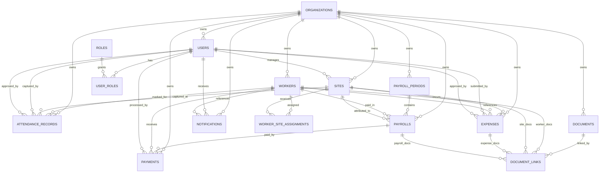

# SQLite Database Design for Labour ERP

## 1. Purpose

This document turns the approved Labour ERP architecture into a SQLite-first relational schema and SQLAlchemy model design. It is intended for the first production release while keeping the data model portable enough for a later PostgreSQL migration if workload or deployment needs grow.

## 2. Design Goals

- Support 10,000+ workers across multiple sites
- Preserve clean module boundaries across users, workers, attendance, payroll, expenses, documents, and notifications
- Enforce strong data integrity with foreign keys, unique constraints, and check constraints
- Keep reporting queries fast through targeted composite indexes
- Stay SQLite-compatible without introducing API code

## 3. SQLite Suitability and Operating Notes

SQLite is acceptable for the first production release if the deployment model is:

- Single application instance or tightly controlled write concurrency
- Moderate concurrent writes with short transactions
- Strong indexing and periodic maintenance

Recommended SQLite runtime settings:

- `PRAGMA foreign_keys = ON`
- `PRAGMA journal_mode = WAL`
- `PRAGMA synchronous = NORMAL`
- `PRAGMA busy_timeout = 5000`

For scale beyond this operating profile, the schema is intentionally portable to PostgreSQL.

## 4. Core Tables

### Main business tables

- `users`
- `workers`
- `attendance_records`
- `payrolls`
- `payments`
- `sites`
- `expenses`
- `documents`
- `notifications`

### Supporting tables

- `organizations`
- `roles`
- `user_roles`
- `worker_site_assignments`
- `payroll_periods`
- `document_links`

These supporting tables are required to keep the main tables normalized and maintainable.

## 5. Entity Relationship Diagram

## 6. Table Relationships

### organizations

- One organization has many users, workers, sites, payroll periods, payrolls, payments, expenses, documents, and notifications.

### users

- Belongs to one organization
- Many-to-many with roles through `user_roles`
- One-to-many to attendance records as capturer and approver
- One-to-many to expenses as submitter and approver
- One-to-many to documents as uploader
- One-to-many to notifications as recipient

### workers

- Belongs to one organization
- One-to-many to site assignments
- One-to-many to attendance records
- One-to-many to payrolls
- One-to-many to payments
- Optional one-to-many to expenses
- One-to-many to linked documents

### sites

- Belongs to one organization
- Optional manager linked to a user
- One-to-many to worker assignments
- One-to-many to attendance, payroll attribution, payments, and expenses

### attendance_records

- Belongs to one organization
- References one worker
- References one site
- References one capturing user
- Optionally references one approving user

### payroll_periods

- Belongs to one organization
- Created by one user
- One-to-many to payroll rows

### payrolls

- Belongs to one organization
- References one payroll period
- References one worker
- Optionally references one site
- One-to-many to payments
- Optional one-to-many to linked documents

### payments

- Belongs to one organization
- Optionally references one payroll row
- Optionally references one worker
- Optionally references one site
- Optionally references one processing user

### expenses

- Belongs to one organization
- References one site
- Optionally references one worker
- References one submitting user
- Optionally references one approving user
- Optional one-to-many to linked documents

### documents

- Belongs to one organization
- References one uploading user
- Linked to business entities through `document_links`

### notifications

- Belongs to one organization
- References one user
- Optionally references one worker

## 7. Foreign Keys

| Table | Column | References | Delete Rule |
|---|---|---|---|
| `roles` | `organization_id` | `organizations.id` | `CASCADE` |
| `users` | `organization_id` | `organizations.id` | `CASCADE` |
| `user_roles` | `user_id` | `users.id` | `CASCADE` |
| `user_roles` | `role_id` | `roles.id` | `CASCADE` |
| `sites` | `organization_id` | `organizations.id` | `CASCADE` |
| `sites` | `site_manager_user_id` | `users.id` | `SET NULL` |
| `workers` | `organization_id` | `organizations.id` | `CASCADE` |
| `worker_site_assignments` | `organization_id` | `organizations.id` | `CASCADE` |
| `worker_site_assignments` | `worker_id` | `workers.id` | `CASCADE` |
| `worker_site_assignments` | `site_id` | `sites.id` | `CASCADE` |
| `attendance_records` | `organization_id` | `organizations.id` | `CASCADE` |
| `attendance_records` | `worker_id` | `workers.id` | `RESTRICT` |
| `attendance_records` | `site_id` | `sites.id` | `RESTRICT` |
| `attendance_records` | `captured_by_user_id` | `users.id` | `RESTRICT` |
| `attendance_records` | `approved_by_user_id` | `users.id` | `SET NULL` |
| `payroll_periods` | `organization_id` | `organizations.id` | `CASCADE` |
| `payroll_periods` | `created_by_user_id` | `users.id` | `RESTRICT` |
| `payrolls` | `organization_id` | `organizations.id` | `CASCADE` |
| `payrolls` | `payroll_period_id` | `payroll_periods.id` | `CASCADE` |
| `payrolls` | `worker_id` | `workers.id` | `RESTRICT` |
| `payrolls` | `site_id` | `sites.id` | `SET NULL` |
| `payments` | `organization_id` | `organizations.id` | `CASCADE` |
| `payments` | `payroll_id` | `payrolls.id` | `SET NULL` |
| `payments` | `worker_id` | `workers.id` | `SET NULL` |
| `payments` | `site_id` | `sites.id` | `SET NULL` |
| `payments` | `processed_by_user_id` | `users.id` | `SET NULL` |
| `expenses` | `organization_id` | `organizations.id` | `CASCADE` |
| `expenses` | `site_id` | `sites.id` | `RESTRICT` |
| `expenses` | `worker_id` | `workers.id` | `SET NULL` |
| `expenses` | `submitted_by_user_id` | `users.id` | `RESTRICT` |
| `expenses` | `approved_by_user_id` | `users.id` | `SET NULL` |
| `documents` | `organization_id` | `organizations.id` | `CASCADE` |
| `documents` | `uploaded_by_user_id` | `users.id` | `RESTRICT` |
| `document_links` | `organization_id` | `organizations.id` | `CASCADE` |
| `document_links` | `document_id` | `documents.id` | `CASCADE` |
| `document_links` | `worker_id` | `workers.id` | `CASCADE` |
| `document_links` | `site_id` | `sites.id` | `CASCADE` |
| `document_links` | `expense_id` | `expenses.id` | `CASCADE` |
| `document_links` | `payroll_id` | `payrolls.id` | `CASCADE` |
| `notifications` | `organization_id` | `organizations.id` | `CASCADE` |
| `notifications` | `user_id` | `users.id` | `CASCADE` |
| `notifications` | `worker_id` | `workers.id` | `SET NULL` |

## 8. Indexing Strategy

The schema uses a mix of unique and composite indexes to support operational reads at 10,000+ worker scale.

### High-value indexes

- `users`
  - unique on `(organization_id, email)`
  - unique on `(organization_id, phone)`
  - index on `(organization_id, status)`

- `workers`
  - unique on `(organization_id, worker_code)`
  - unique on `(organization_id, id_document_number)`
  - index on `(organization_id, status)`
  - index on `(organization_id, first_name, last_name)`
  - index on `(organization_id, phone)`

- `sites`
  - unique on `(organization_id, site_code)`
  - index on `(organization_id, status)`
  - index on `(organization_id, name)`

- `worker_site_assignments`
  - unique on `(worker_id, site_id, assigned_from)`
  - index on `(site_id, status)`
  - index on `(worker_id, status)`

- `attendance_records`
  - unique on `(organization_id, worker_id, attendance_date)`
  - index on `(site_id, attendance_date)`
  - index on `(organization_id, approval_status, attendance_date)`
  - index on `(organization_id, payroll_locked, attendance_date)`
  - index on `(worker_id, attendance_date)`

- `payroll_periods`
  - unique on `(organization_id, name)`
  - index on `(organization_id, status)`
  - index on `(organization_id, period_start, period_end)`

- `payrolls`
  - unique on `(organization_id, payroll_period_id, worker_id)`
  - index on `(payroll_period_id, status)`
  - index on `(organization_id, worker_id)`
  - index on `(organization_id, site_id)`

- `payments`
  - unique on `(organization_id, external_reference)`
  - index on `(organization_id, status, payment_date)`
  - index on `(payroll_id)`
  - index on `(worker_id, payment_date)`

- `expenses`
  - index on `(site_id, expense_date)`
  - index on `(organization_id, status, expense_date)`
  - index on `(organization_id, category, expense_date)`

- `documents`
  - index on `(organization_id, category)`
  - index on `(organization_id, valid_to)`
  - index on `(checksum)`

- `document_links`
  - index per foreign-key target column for fast entity lookups

- `notifications`
  - index on `(user_id, is_read, created_at)`
  - index on `(organization_id, status)`

## 9. SQLAlchemy Model Package

The SQLAlchemy models are defined in:

- [backend/src/database/base.py](C:/Users/Asus/python/labour_v0/backend/src/database/base.py)
- [backend/src/database/models.py](C:/Users/Asus/python/labour_v0/backend/src/database/models.py)
- [backend/src/database/__init__.py](C:/Users/Asus/python/labour_v0/backend/src/database/__init__.py)

Implementation choices:

- SQLAlchemy 2-style typed declarative models
- UUID strings as primary keys for portability
- Explicit relationship definitions for all business links
- Composite indexes for heavy read paths
- Check constraints for money, dates, and attachment integrity

## 10. Scalability Notes for 10,000+ Workers

### Query strategy

- Attendance, payroll, and expense queries are optimized around organization, site, status, and date
- Worker lookup paths use code, phone, and name indexes
- Period-based payroll queries avoid full table scans

### Write strategy

- Bulk attendance and payroll writes should use batch inserts/updates inside short transactions
- Avoid long-running write locks in SQLite
- Archive or summarize historical reporting data if growth becomes heavy

### Operational strategy

- Use WAL mode to improve concurrent read/write behavior
- Schedule backups and periodic `VACUUM`/`ANALYZE`
- Keep document binaries out of SQLite; store only metadata and storage path in the database

### Migration readiness

- The relational design is compatible with a future PostgreSQL move
- The current SQLAlchemy models intentionally avoid SQLite-only business structures

## 11. Recommended Next Step

The next logical step is to generate migration-ready schema creation files and project scaffolding around these models, without yet building APIs.
